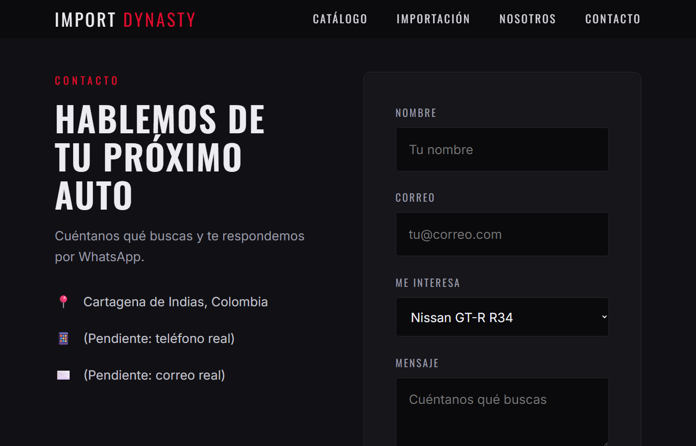

# Import Dynasty CTG

Sitio web de **Import Dynasty CTG**, concesionario en Cartagena (Colombia) especializado en la importación y venta de los autos más icónicos del mercado JDM: Nissan Skyline GT-R R34, Mazda RX-7 FD y Mitsubishi Lancer Evolution X, entre otros.

🌐 **Míralo en vivo: [import-dynasty.netlify.app](https://import-dynasty.netlify.app)**

El sitio es estático (HTML, CSS y JavaScript puro), sin dependencias ni paso de compilación.


## Páginas

| Página | Archivo | Contenido |
| --- | --- | --- |
| Inicio | `index.html` | Portada, catálogo, proceso de importación, nosotros y contacto |
| Nissan Skyline GT-R R34 | `nissan-gtr-r-34.html` | Ficha técnica, galería y cotización |
| Mazda RX-7 FD | `mazda-rx7.html` | Ficha técnica, galería y cotización |
| Mitsubishi Lancer Evo X | `lancerevo.html` | Ficha técnica, galería, equipamiento y cotización |

## Capturas




## Características

- Diseño oscuro estilo JDM, con animaciones al hacer scroll y contadores animados.
- Totalmente responsive, con menú hamburguesa en móvil.
- Sección "Importación" que explica el proceso en 4 pasos.
- Fichas de cada auto con datos rápidos, especificaciones y galería con lightbox.
- Formulario de contacto que envía el mensaje por WhatsApp.
- Respeta `prefers-reduced-motion` y tiene navegación accesible por teclado.

## Estructura

```
├── index.html
├── nissan-gtr-r-34.html
├── mazda-rx7.html
├── lancerevo.html
├── estilos/dynasty.css    # sistema de diseño (variables, componentes)
├── js/main.js             # menú, reveal, lightbox, formulario
├── imagenes/              # fotos de los autos
└── screenshots/           # capturas para este README
```

## Ejecutar en local

No requiere instalación. Abre `index.html` en el navegador o usa la extensión **Live Server** de VS Code.

## Configuración pendiente

- **WhatsApp:** cambia la variable `numero` en `js/main.js` por el número real, en formato internacional y sin `+` (por ejemplo `573001234567`).
- **Contacto:** reemplaza los marcadores "Pendiente" de teléfono y correo en la sección de contacto de `index.html`.

## Tecnologías

- HTML5
- CSS3 (variables, Grid, Flexbox)
- JavaScript (vanilla)
- Google Fonts: Oswald, Inter y Noto Serif JP
